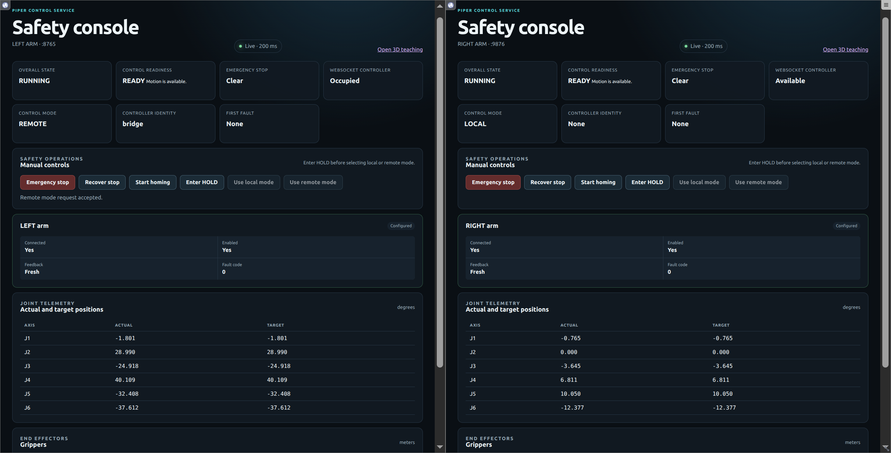
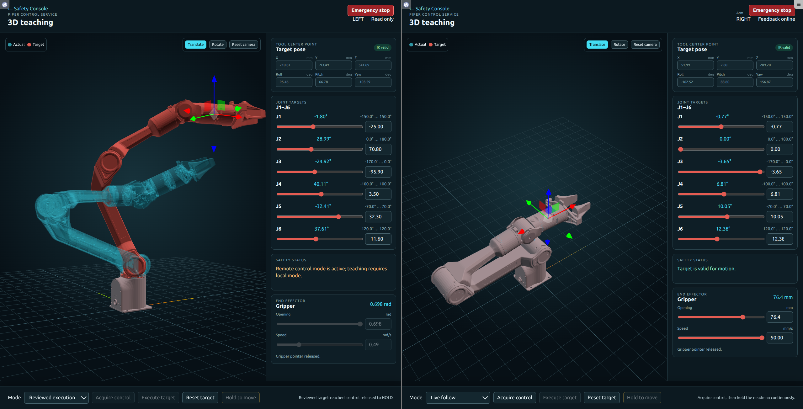

# Piper Teach Pad

[简体中文](README.zh-CN.md)

Piper Teach Pad is a public dual-arm control stack for AgileX Piper robots. Its core
scenario combines a **Safety Console** management terminal, a browser **Teach Pad**,
bridge interfaces for algorithms or teleoperation (`piper-control-bridge`, the arm
bridge, and `camera-bridge`), and a retained MuJoCo environment for verifying the
same APIs without CAN. 

## Safety boundary

> **Robot motion can injure people and damage equipment.** Use this software only
> under trained, on-site supervision. Before enabling either arm, clear its full
> workspace, verify the physical E-stop, arm readiness and fresh feedback, check
> joint/gripper limits and stable CAN-to-arm mapping, and begin with conservative
> speed and a short motion. Keep an operator at the E-stop during first motion.
> The physical E-stop (急停) remains the final safety measure.

The web and bridge services have **no authentication or transport encryption**. Bind
them only on a trusted, isolated LAN; never expose their ports to an untrusted
network or the Internet. This project is not safety certified or production
hardened. MuJoCo is an interface/scene check, not a physical safety certification
(物理安全认证), risk assessment, or permission to move hardware. A direct controller
control-lease disconnect enters HOLD. A downstream piper-control-bridge client
disconnect only releases that client's priority lanes: another queued priority lane
may take over, while the Bridge's upstream connection and controller may remain
RUNNING while holding/commanding the current position. Never treat downstream
disconnect as a stop; use the Safety Console or controller E-stop/HOLD. Do not
substitute `kill -9`, power removal, or CAN shutdown for a controlled stop.

## Components and default endpoints

| Component | Executable / route | Default endpoint | Purpose |
|---|---|---|---|
| Controller | `piper-control` | left `8765`, right `9876` | Safety state machine, REST/WebSocket and web UI |
| Safety Console | `GET /` | `http://HOST:8765/`, `http://HOST:9876/` | State, readiness, E-stop, recovery, homing and mode |
| Teach Pad | `GET /teach` | `http://HOST:8765/teach`, `http://HOST:9876/teach` | Per-arm teaching and gripper control |
| Arm bridge | `piper-control-bridge` | left `18765`, right `19876` | Prioritized multi-client WebSocket interface |
| Camera bridge | `camera-bridge` | `tcp://HOST:15555` | Seven latest-frame ZeroMQ topics |
| CAN tool | `piper-control-can` | local SocketCAN | Validated `up`, `status`, `down` at 1 Mbit/s |
| Calibration | `piper-calibrate` | local SocketCAN | Read-only raw-joint calibration report |

Each arm is independent and accepts six joint values plus one scalar gripper value.
Both arms use native Piper grippers. Joint positions/speeds use degrees and
degrees/second. Gripper wire/API commands use metres and metres/second (`m/s`); the
Teach Pad converts them to `mm` and `mm/s` for display.

## Prerequisites and installation

Use Linux and Python 3.10 or newer; hardware needs SocketCAN. A browser serves the
two web consoles. Node.js/npm is needed only to rebuild/test the Teach Pad bundle.
The interactive MuJoCo viewer needs GLFW and `DISPLAY`; headless mode does not.

```bash
git clone --recurse-submodules git@github.com:Atombite/Piper-teachpad.git
cd Piper-teachpad
git submodule update --init --recursive
python3 -m venv .venv
.venv/bin/pip install -e '.[dev]'
```

Optional extras are composable:

```bash
.venv/bin/pip install -e '.[dev,mujoco,camera,dataset]'
npm ci
```

`mujoco` provides dynamics; `camera` provides V4L2/RealSense/ZeroMQ support;
`dataset` provides Parquet support for LeRobot; `dev` provides test dependencies.
The driver uses the authoritative [AgileX Piper SDK](https://github.com/agilexrobotics/piper_sdk).
The model comes from [Google DeepMind MuJoCo Menagerie](https://github.com/google-deepmind/mujoco_menagerie/tree/main/agilex_piper).

## Configuration and discovery

Start from the retained, validated examples:

- `config/piper-control.example.yaml`: real left/right Piper controllers;
- `config/piper-control-bridge.example.yaml`: left/right arm bridges;
- `config/piper-control.mujoco.yaml`: dual-arm MuJoCo world;
- `config/camera.yaml`: one V4L2 wrist camera and two RealSense cameras.

Copy before editing. Keep `arms.left` and/or `arms.right`; arm names, CAN interfaces
and HTTP ports must be unique. The map key is the side. `backend: piper` is required
for every enabled gripper. Review calibration, logical limits, speed limits and reset
pose for the actual hardware.

Discover stable identifiers locally; never copy another robot's values. Use each
mechanism only for its labeled device type:

```bash
# GELLO/serial devices (not the CAN udev-rule source):
ls -l /dev/serial/by-id/

# camera devices:
ls -l /dev/v4l/by-id/
rs-enumerate-devices

# USB-CAN adapters: first list the current CAN netdev names, then inspect each one.
ip -details link show type can
udevadm info --attribute-walk --path=/sys/class/net/can0
udevadm info --attribute-walk --path=/sys/class/net/can1
```

In each USB-CAN attribute walk, locate the adapter's `ATTRS{serial}` value. Physically
verify which adapter is connected to the left and right arm (for example, inspect one
adapter at a time) before replacing `REPLACE_WITH_LEFT_PIPER_CAN_ADAPTER_SERIAL` and
`REPLACE_WITH_RIGHT_PIPER_CAN_ADAPTER_SERIAL` in `deploy/70-piper-can.rules`. Replace
camera placeholders separately in `config/camera.yaml`. Replug USB-CAN adapters or
reboot after installing udev rules, then confirm `can_left`/`can_right` against the
physical arms before motion. Controller CAN is fixed at 1,000,000 bit/s:

```bash
sudo .venv/bin/piper-control-can --config config/piper-control.example.yaml up
.venv/bin/piper-control-can --config config/piper-control.example.yaml status
```

The wrappers `scripts/can-up.sh`, `scripts/can-status.sh`, and `scripts/can-down.sh`
call the same CLI from the repository environment.

### Read-only calibration

Stop controller services and place each arm at the intended logical reset pose.
`piper-calibrate` reads raw joint feedback; it does not enable, home, HOLD, E-stop,
reset, disable, or command an arm. Keep still for the initial 50 fresh frames, slowly
cover the reviewed range, then press Ctrl+C:

```bash
.venv/bin/piper-calibrate --config config/piper-control.example.yaml > calibration-result.yaml
```

Review the report before copying its calibration and min/max values.

## Run real arms and bridges

Bring up CAN, confirm it, then run all configured arms (or add `--side left` or
`--side right`):

```bash
sudo .venv/bin/piper-control-can --config config/piper-control.example.yaml up
.venv/bin/piper-control --config config/piper-control.example.yaml --lock-path /tmp/piper-control-demo.lock
```

Manual runs use an explicit user-writable lock under `/tmp`. The systemd units instead
create per-arm runtime directories and use their configured
`/run/piper-control-ARM/piper-control.lock` paths.

Every restart begins in `local`. Inspect both Safety Consoles, verify feedback and
the physical E-stop before motion. Bridge control uses the deliberate transition
`RUNNING → HOLD → local/remote → RUNNING`; mode changes are accepted only from HOLD.

```bash
.venv/bin/piper-control-bridge --config config/piper-control-bridge.example.yaml --side left
.venv/bin/piper-control-bridge --config config/piper-control-bridge.example.yaml --side right
```

The Teach Pad identifies with `{"id":"h1","cmd":"hello","identity":"local"}`;
the bridge identifies upstream with
`{"id":"h1","cmd":"hello","identity":"bridge"}`. Algorithms connect to bridge
ports only after the corresponding arm is in `remote`.

### systemd

The installer validates both YAML files before copying a root-owned runtime and does
not enable or start services:

```bash
SERVICE_USER="$USER"  # Set this to an existing non-root service account.
sudo scripts/install-service.sh "$SERVICE_USER" config/piper-control.example.yaml \
  config/piper-control-bridge.example.yaml
sudo systemctl start piper-control-can.service
sudo systemctl start piper-control@left.service piper-control@right.service
sudo systemctl start piper-control-bridge@left.service piper-control-bridge@right.service
systemctl status piper-control@left.service piper-control@right.service \
  piper-control-bridge@left.service piper-control-bridge@right.service
```

The four arm units are `piper-control@left`, `piper-control@right`,
`piper-control-bridge@left`, and `piper-control-bridge@right`. Startup orders
controllers before bridges; stop/restart orders bridges before controllers.

## Safety Console and Teach Pad

Open `/` on either controller for its Safety Console. It reports state, feedback and
fault reason, keeps E-stop available, and supports deliberate recovery, homing and
local/remote changes. Never restart merely to bypass a latched fault.



Open `/teach` on the same port for the Teach Pad. It renders an offline Piper URDF
and controls only that port's arm:

- **Preview** edits a target without acquiring control or sending motion.
- **Reviewed execution** sends one frozen target after rechecking state, identity
  and limits.
- **Live follow** needs explicit acquisition and continuous hold-to-move input;
  release, focus loss, stale feedback, state change, or network failure disconnects
  and causes HOLD.
- The gripper card uses the same exclusive lease and native Piper limits.



One controller port accepts one control client. A conflict closes with
`CLIENT_CONFLICT`; the two arm ports remain independent.

## Controller and arm-bridge interfaces

Controller WebSockets are `ws://HOST:8765/ws/control` and
`ws://HOST:9876/ws/control`. They support `get_state`, `get_base_info`, `servoJ`, and
`move_gripper`; the first frame must be the correct `hello`. A strict client is
provided:

```python
import asyncio
from examples.ws_client import PiperControlClient

async def main():
    async with PiperControlClient("ws://127.0.0.1:8765/ws/control") as client:
        state = await client.get_state()
        info = await client.get_base_info()
        await client.servo_j([0.0] * 6, speed=[5.0] * 6)
        await client.move_gripper(0.02, speed=0.01)
        print({"state": state, "base_info": info})

asyncio.run(main())
```

The arm bridge exposes those motion/state commands without `hello`, adds integer
`priority` to `servoJ`/`move_gripper`, and accepts
`{"id":"r1","cmd":"release","priority":100}`. Joint and gripper commands share
whole-arm ownership: higher priority preempts; equal priority keeps the owner.
Commands expire after 1 second (1 秒), ownership expires after 3 seconds (3 秒), and a
lane holds `control rate × 5` commands (控制频率 × 5). Disconnect releases that
client's lanes. An ACK means accepted/queued, not arrived.

Algorithms and teleoperation clients attach to the downstream prioritized Bridge
URLs, **not** the direct controller URLs: left `ws://HOST:18765/ws/control`, right
`ws://HOST:19876/ws/control`. The controller URLs on `8765`/`9876` require `hello`
and enforce local/bridge identity; Bridge URLs require no `hello` and accept
`get_state`, `get_base_info`, `servoJ`, `move_gripper`, and `release`. This copyable
prioritized bridge client sends joints in degrees/degrees per second and Piper
gripper position/speed in metres/metres per second:

```python
import asyncio
import json
import websockets

async def main():
    async with websockets.connect("ws://HOST:18765/ws/control") as bridge:
        requests = (
            {"id": "j1", "cmd": "servoJ", "target_joints": [0.0] * 6,
             "speed": [5.0] * 6, "priority": 100},
            {"id": "g1", "cmd": "move_gripper", "target_position": 0.02,
             "speed": 0.01, "priority": 100},
            {"id": "r1", "cmd": "release", "priority": 100},
        )
        for request in requests:
            await bridge.send(json.dumps(request))
            response = json.loads(await bridge.recv())
            if response.get("id") != request["id"] or response.get("ok") is not True:
                raise RuntimeError(response)
            print(response)

asyncio.run(main())
```

## Dual-arm MuJoCo verification

MuJoCo mode does not construct the hardware driver and does not open CAN (不打开 CAN).

```bash
git submodule update --init --recursive
.venv/bin/pip install -e '.[mujoco]'
.venv/bin/piper-control --config config/piper-control.mujoco.yaml --mujoco --lock-path /tmp/piper-control-demo.lock
.venv/bin/piper-control --config config/piper-control.mujoco.yaml --mujoco-headless --lock-path /tmp/piper-control-demo.lock
```

Use headless mode when `DISPLAY` is unavailable. Closing the Viewer (关闭 Viewer)
requests normal shutdown. The bases are 52.6 cm apart. The 0–100 mm Piper API range
maps to the 0–70 mm model range (`100 mm -> 70 mm`). While it runs, this bounded
check keeps both clients open until joints and grippers converge:

```bash
PYTHONPATH=. .venv/bin/python - <<'PY'
import asyncio
from examples.ws_client import PiperControlClient

LEFT_TARGET = [0, 45, -45, 5, 5, 5]
RIGHT_TARGET = [0, 55, -55, -5, -5, -5]
LEFT_GRIPPER = 0.10
RIGHT_GRIPPER = 0.05

def close_enough(actual, target, tolerance):
    return all(abs(a - b) <= tolerance for a, b in zip(actual, target, strict=True))

async def main():
    async with (
        PiperControlClient("ws://127.0.0.1:8765/ws/control") as left,
        PiperControlClient("ws://127.0.0.1:9876/ws/control") as right,
    ):
        await asyncio.gather(
            left.servo_j(LEFT_TARGET),
            right.servo_j(RIGHT_TARGET),
            left.move_gripper(LEFT_GRIPPER),
            right.move_gripper(RIGHT_GRIPPER),
        )
        loop = asyncio.get_running_loop()
        deadline = loop.time() + 20.0
        states = None
        while loop.time() < deadline:
            left_state, right_state = await asyncio.gather(
                left.get_state(), right.get_state()
            )
            states = {"left": left_state, "right": right_state}
            if (
                close_enough(left_state["ActualQ"], LEFT_TARGET, 2.0)
                and close_enough(right_state["ActualQ"], RIGHT_TARGET, 2.0)
                and abs(left_state["ActualGripper"] - LEFT_GRIPPER) <= 0.015
                and abs(right_state["ActualGripper"] - RIGHT_GRIPPER) <= 0.015
            ):
                print(states)
                return
            await asyncio.sleep(0.1)
        raise TimeoutError(f"MuJoCo targets did not converge within 20 s: {states}")

asyncio.run(main())
PY
```

Lightweight simulation also avoids CAN:

```bash
.venv/bin/piper-control --config config/piper-control.example.yaml --simulate --lock-path /tmp/piper-control-sim.lock
```

## Generic algorithm and teleoperation examples

The retained GELLO and LeRobot examples are alternatives to the prioritized arm
Bridge. They instantiate `PiperControlClient` with its default `identity="local"` and
connect directly to controller ports `8765`/`9876`. Before motion, keep both
controllers in `local mode` and release Teach Pad or any other client so each example
has exclusive control. Never point these examples at Bridge ports `18765/19876`;
clients that need priority arbitration must use the raw Bridge protocol above.

Install GELLO from its [upstream repository](https://github.com/wuphilipp/gello_software),
align each leader within the default 5° tolerance, and start at the default low speed
(低速) of 10°/s. Two motion gates are required:

```bash
.venv/bin/python examples/gello_ws_teleop.py \
  --left-port /dev/serial/by-id/REPLACE_WITH_LEFT_GELLO_SERIAL_DEVICE \
  --right-port /dev/serial/by-id/REPLACE_WITH_RIGHT_GELLO_SERIAL_DEVICE \
  --left-url ws://127.0.0.1:8765/ws/control \
  --right-url ws://127.0.0.1:9876/ws/control \
  --allow-motion --confirm-motion I_UNDERSTAND
```

It streams six joints at 50 Hz and intentionally ignores the GELLO gripper channel.
A limit, serial, state or WebSocket error closes the affected side into HOLD.

For LeRobot, install `.[dataset]`. Without motion gates this validates and summarizes
the selected episode without opening WebSockets:

```bash
.venv/bin/python examples/lerobot_ws_replay.py /path/to/piper-dataset \
  --source actions --episode-index 0
```

Supervised replay adds a conservative rate and both gates:

```bash
.venv/bin/python examples/lerobot_ws_replay.py /path/to/piper-dataset \
  --source actions --rate 0.5 \
  --left-url ws://127.0.0.1:8765/ws/control \
  --right-url ws://127.0.0.1:9876/ws/control \
  --joint-speed-deg-s 10 \
  --gripper-speed-m-s 0.02 --allow-motion --confirm-motion I_UNDERSTAND
```

The accepted v2 layout has 16 float32 values: left J1–J6, left gripper, right J1–J6,
right gripper, then duplicate grippers. Joints are radians in the dataset and degrees
on the API; grippers remain metres.

## Camera bridge

Edit `config/camera.yaml` with locally discovered identifiers, install the extra, and
run manually:

```bash
.venv/bin/pip install -e '.[camera]'
.venv/bin/camera-bridge --config config/camera.yaml
```

For systemd, the installer validates before mutation and does not start the unit:

```bash
SERVICE_USER="$USER"  # Set this to an existing non-root service account.
sudo scripts/install-camera-service.sh "$SERVICE_USER" config/camera.yaml
sudo systemctl start camera-bridge.service
systemctl status camera-bridge.service
```

Both installers verify that `SERVICE_USER` exists before changing the system. Do not
run the installed services as root; if `$USER` is root, name a dedicated existing
non-root account instead.

After both the arm services and `camera-bridge.service` have been installed and their
configs reviewed, `scripts/start.sh` is the all-stack helper: it starts camera,
controllers, then arm bridges. Do not use it after an arm-only install because the
camera unit does not yet exist. `scripts/status.sh`, `scripts/restart.sh`, and
`scripts/stop.sh` likewise operate on the complete installed stack.

Seven topics include `camera/left_wrist/color`, `camera/right_wrist/depth`, and
`camera/head/infrared_2`. Each image is `topic + JSON metadata + payload`. Use
`host_monotonic_ns` for frame age/pairing. The subscriber uses `RCVHWM=14` and drains
to the newest frame:

```bash
PYTHONPATH=src .venv/bin/python examples/camera_zmq_client.py \
  --endpoint tcp://127.0.0.1:15555 --duration 10 --max-age-ms 500
PYTHONPATH=src .venv/bin/python examples/camera_preview_gui.py \
  --endpoint 127.0.0.1:15555
```

`Restart=no` keeps a camera fault visible. One timeout is tolerated; three
consecutive failures (连续 3 次) cause global fault. A definite disconnect pauses all
images and permits one reconnect only (唯一一次重连). Inspect details with:

```bash
journalctl -u camera-bridge.service -b
```

## Validation and troubleshooting

```bash
.venv/bin/python -m pytest -q
.venv/bin/python -m compileall -q src examples tools
for f in scripts/*.sh; do bash -n "$f"; done
npm ci
npm run build:teach
npm run build:teach-tests
git diff --check
```

- Configuration: compare all four public YAML examples; check unique endpoints,
  Piper gripper backend, calibration and limits.
- CAN: inspect stable mapping, 1 Mbit/s bitrate, termination and wiring.
- `EMERGENCY_STOP`: fix `fault_reason`, verify physical safety, then recover
  deliberately; never bypass the latch.
- WebSocket rejection: check ownership, identity/mode and `RUNNING` state.
- MuJoCo model: initialize submodules and verify
  `thirdparty/mujoco_menagerie/agilex_piper/piper.xml`.
- Viewer: use `--mujoco-headless` without `DISPLAY`.
- Camera: validate identifiers and inspect `journalctl -u camera-bridge.service -b`;
  do not hide vision loss with restart loops.

## Repository layout

- `src/piper_control/`: controller, consoles, arm bridge and camera bridge.
- `config/`: real-arm, bridge, camera and MuJoCo examples.
- `examples/`: WebSocket, GELLO, LeRobot and camera clients.
- `scripts/`, `deploy/`: CAN and systemd operations.
- `tests/`: Python, browser-side JS and simulation checks.
- `thirdparty/mujoco_menagerie/`: pinned public model submodule.

## License and attribution

Copyright © 2026-2026 atombite.ai

Licensed under Apache License 2.0 (`Apache-2.0`). See [LICENSE](LICENSE) and
[NOTICE](NOTICE). Bundled models and browser dependencies retain their own terms; see
[THIRD_PARTY_NOTICES.md](THIRD_PARTY_NOTICES.md). Redistributors must preserve the
required copyright, license, NOTICE and third-party notices.

Canonical source: <https://github.com/Atombite/Piper-teachpad>
